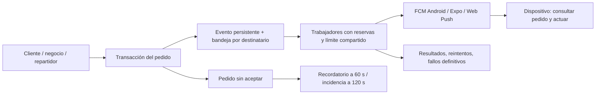

# PIDEYA: notificaciones operativas y capacidad

Estado: implementación local y pruebas aisladas. No desplegada, sin migraciones aplicadas a producción, sin mensajes enviados a usuarios. La revisión cubre código del cliente, KDS, repartidor, web y migraciones disponibles; no certifica funciones/triggers existentes únicamente en Supabase remoto.

## Decisión

El pedido es la fuente de verdad. Una notificación es un aviso para consultar ese pedido y actuar; no debe crear pedidos, aceptar entregas ni sustituir el historial. Para PIDEYA conviene un outbox transaccional y trabajadores persistentes, no un HTTP por cada escritura ni confiar en que las pantallas estén abiertas. Un webhook autenticado puede despertar trabajadores más adelante; no es necesario para conservar y procesar los eventos. La cola se consulta de forma acotada por app.

## Propuesta de valor y contrato de comunicación

| Participante | Valor que debemos proteger | Eventos operativos | Confirmación relevante |
|---|---|---|---|
| Cliente | Comprar con dirección y cobertura conocidas; conocer avance real | Aceptado, preparación, surtido, ajustes, listo, en camino, entregado, rechazo/cancelación | Estado del pedido y aprobación explícita de sustituciones |
| Restaurante/comercio | No perder ventas; aceptar según capacidad; surtir correctamente | Pedido nuevo, recordatorio, cliente confirma surtido, cancelación/entrega | Aceptar/rechazar en servidor, no abrir una notificación |
| Repartidor | Saber qué entrega tiene asignada y evitar recorridos equivocados | Asignación, desasignación/reasignación, listo, cancelación | Consultar asignación vigente; la confirmación operativa del repartidor requiere definir un estado propio |
| Operación | Detectar pedidos abandonados y fallos del proveedor | Incidencias, atraso de cola, errores definitivos, tokens inválidos | Resolución del pedido y gestión humana de la incidencia |
| Marketing | Recompra con consentimiento | Campañas programadas y segmentadas | Cola y consentimiento separados; nunca prioridad sobre pedidos |

## Hallazgos del sistema anterior

- `supabase/functions/notify-restaurant/index.ts` solo imprime el cuerpo y devuelve éxito. No envía push ni persiste trabajo. La nueva web deja de invocarlo; no debe anunciarse como un sistema funcional de avisos.
- Migración 019 del repartidor publica `pg_notify` sin consumidor incluido. Solo cubre NULL → repartidor, no reasignación. `LISTEN/NOTIFY` no constituye una cola durable para consumidores desconectados.
- El panel enviaba dos pushes por cambio de estado y dos por promoción directamente a Expo desde el navegador. También repetía notificaciones locales a los cuatro segundos, aunque el pedido ya pudiera estar atendido.
- El cliente marcaba registro como terminado antes de tener perfil/teléfono. Una primera ejecución temprana podía dejar la cuenta sin token. Las pulsaciones solo se registraban en consola y el aviso local usaba número de pedido como si fuera UUID.
- KDS no tenía registro de token remoto. Audio/Realtime y notificaciones locales no garantizan avisos con proceso cerrado. La consulta inicial omitía PICKING/ADJUSTED y permitía consulta sin restaurante.
- Web tenía manejador `push` en su service worker, pero no registraba `PushManager.subscribe`, claves VAPID ni un emisor Web Push. El permiso de Notification por sí solo no resuelve esto.
- No se encontraron recibos Expo, reintentos durables, reservas entre consumidores, historial de fallos, expiración ni límite global entre servidores.
- Riesgos heredados fuera del transporte: `025_fix_driver_tracking_rpc.sql` acepta un `p_order_id` y actualiza el pedido sin comprobar que pertenezca al repartidor autenticado; `026_storage_bucket_and_app_settings.sql` permite modificar ajustes a cualquier usuario autenticado y sus políticas de almacenamiento no acotan propietario. Deben corregirse y verificarse contra las políticas reales antes de abrir el sistema masivamente. La RLS histórica de pedidos también es demasiado amplia.
- GPS actualiza `orders`; el cliente volvía a consultar historial y pedidos activos por cada actualización, además de polling de ocho segundos. Eso amplifica las consultas sin aportar valor al historial.

## Implementación entregada

### Backend y trabajador

- Migración 031: rutas desactivadas inicialmente, endpoints privados, registro por identidad validada, hasta diez dispositivos activos por identidad/app, bandeja con RLS y eventos por revisión del pedido. El repartidor también puede registrar con su token de acceso vigente sin depender de OTP.
- El trigger y el cambio del pedido están en la misma transacción. El fallo de persistencia aborta esa transacción; no se informa éxito si no se pudo guardar el evento. Esto aumenta la importancia de monitorear tamaño y disponibilidad de la base.
- Unicidad por evento/destinatario/dispositivo, índices por app y trabajo disponible, `FOR UPDATE SKIP LOCKED`, reservas de dos minutos y UUID de reserva para rechazar respuestas de trabajadores antiguos.
- Confirmación de resultados por lote: una RPC para hasta cien resultados, sin una petición REST adicional por dispositivo.
- Reintentos con espera exponencial y variación aleatoria; ocho intentos; vencimiento a treinta minutos. Los errores 429/503 pausarán la ruta compartida además de diferir trabajos. Tokens inválidos se desactivan.
- Eventos atrasados del cliente, pedidos ya atendidos y asignaciones que cambiaron se descartan antes de enviar. La información se vuelve a consultar en la app; el push no contiene dirección, teléfono, precios ni datos de farmacia.
- Expo: lotes de cien por app/proyecto, tickets y revisión de recibos a los quince minutos; reconsulta de recibos pendientes hasta un máximo de veintitrés horas desde el evento.
- FCM HTTP v1: adaptador Android, credencial por proyecto, OAuth reutilizable, TTL y tag por evento. Es una opción explícita, no se activa automáticamente ni se agregan credenciales al cliente.
- Web Push: librería de cifrado `web-push`, VAPID exclusivamente en el servidor, destinos de proveedores permitidos para evitar peticiones a destinos arbitrarios.
- Migración 032: un recordatorio por pedido pendiente tras sesenta segundos; incidencia tras ciento veinte segundos; resolución al abandonar PENDING; vista privada de salud y retención de eventos terminados de treinta días en lotes pequeños.
- Panel de incidencias visible en Configuración del admin al activar v2. Un registro de incidencia **no** llama ni avisa por SMS a un operador: hay que conectar la monitorización de guardia durante el despliegue.

### Aplicaciones

- Registro por cuenta, reintento al volver a primer plano, rotación de token, revocación antes de logout, canal Android creado antes de solicitar permisos y EAS projectId explícito.
- Registro nuevo controlado por `EXPO_PUBLIC_NOTIFICATION_V2=true`; proveedor `expo` por defecto, `EXPO_PUBLIC_NOTIFICATION_PROVIDER=fcm` solo para el despliegue Android directo. No hay implementación APNs directa ni soporte de mezcla Expo/iOS y FCM/Android dentro de una misma ruta: mantener Expo para iOS o ampliar el modelo de rutas antes de lanzar iOS.
- Cliente: navegación desde push validada con la bandeja RLS, incluyendo arranque en frío; registro de apertura separado de entrega al proveedor.
- Deduplicación de avisos visibles en primer plano por eventId, persistida en un historial acotado. FCM utiliza tag y Web Push utiliza tag sin `renotify`.
- KDS: registro remoto, separación entre sonido local antiguo y push v2, reconciliación al reconectar/volver, filtro obligatorio del negocio y estados de surtido en la carga inicial.
- Web: suscripción/restauración Web Push y baja al cerrar sesión, activación ligada al botón de permiso, navegación al panel desde el aviso y eliminación de envíos duplicados. El flujo antiguo de estados se conserva con un solo envío cuando v2 está apagado, para permitir transición controlada.
- Se retira la difusión de campañas desde el navegador. La promoción se guarda y el texto indica honestamente que falta su procesador. El procesador de campañas con consentimiento/segmentación **no forma parte de esta entrega**.
- Historial del cliente: ignora cambios que solo afectan GPS; polling con variación aleatoria solo durante desconexión/error, y reconciliación al reconectar o volver a primer plano. El mapa mantiene su flujo de seguimiento separado.

## Límites de garantía

Persistencia transaccional y unicidad de trabajos no equivalen a entrega exactamente una vez. Si el proveedor acepta y el trabajador muere antes de confirmar en PostgreSQL, la reserva se recupera y puede reenviar. La deduplicación del cliente reduce duplicados, pero el sistema operativo puede mostrar un aviso antes de ejecutar JavaScript, especialmente mediante Expo. No se promete exactamente una vez en pantalla.

`accepted` significa aceptado por FCM/Web Push o recibo exitoso Expo, **no recibido, visto ni aceptado por la persona**. Los permisos revocados, modo no molestar, batería Xiaomi, dispositivo apagado, force-stop y problemas del proveedor siguen requiriendo reconciliación y operación humana. La apertura del cliente se registra; la confirmación de asignaciones por el repartidor y el seguimiento de apertura en KDS/web necesitan una siguiente integración de producto.

Los dispositivos nuevos recuperan eventos recientes al registrarse. Los pedidos de invitados sin UUID autenticado no se notifican al cliente por coincidencia de teléfono: su pantalla de seguimiento sigue siendo el mecanismo actual. Las políticas heredadas de pedidos públicos y el vínculo del usuario deben endurecerse antes de producción; no se debe atribuir un UUID arbitrario enviado por el cliente.

## Qué significan 50 mil usuarios

Concurrencia de usuarios, pedidos por segundo, dispositivos por destinatario y avisos por segundo son medidas distintas. Ejemplos de dimensionamiento, no resultados de carga de producción:

| Escenario | Demanda aproximada |
|---|---|
| 50 mil usuarios realizan un pedido en diez minutos | 83 pedidos/s; con siete avisos/pedido, 583 avisos/s de media |
| 50 mil pedidos llegan en un minuto | 833 pedidos/s; con siete avisos/pedido, 5,833 avisos/s de media; picos mayores |
| 50 mil clientes necesitan un aviso al mismo instante | Expo 600/s: mínimo teórico 83.3 s; configuración conservadora 400/s: 125 s, antes de latencia |
| 50 mil repartidores realmente activos con GPS cada diez segundos | 5,000 escrituras GPS/s; no confundir con 50 mil compradores |

Expo publica 600 notificaciones/s por proyecto. El límite predeterminado de FCM HTTP v1 es 600,000 mensajes/minuto por proyecto, sujeto a cuotas reales, ráfagas y throttling; no garantiza latencia. Para una ráfaga de 50 mil avisos Android con objetivo de pocos segundos, recomendaría FCM directo con cuota confirmada, trabajadores escalados gradualmente y pruebas de carga. La configuración inicial limita a 400/s; no se afirma capacidad de varios miles/s con esos valores.

La ruta comparte presupuesto entre sus trabajadores. Si dos apps usan el mismo proyecto Firebase, sus presupuestos deben sumarse y respetar la cuota de ese proyecto; no asignar el límite completo a ambas. La configuración actual presupone proyectos separados. FCM puede configurarse hasta lotes de cien cada veinte milisegundos (5,000/s), pero ese máximo de configuración NO es una capacidad probada y requiere suficientes trabajadores, medición de base, cuotas y ramp-up. No cambiarlo a ese valor sin ensayo.

También existe cuota por dispositivo: un negocio extremadamente concurrido necesita agrupar avisos y limitar su frecuencia por terminal; el límite compartido actual es por app, no por dispositivo. Ese agrupamiento debe probarse y completarse antes de dirigir ráfagas masivas a un único comercio. No reducir la durabilidad del pedido para silenciar notificaciones.

Realtime Postgres Changes autoriza cambios por suscriptor. Las suscripciones por pantalla y GPS dentro de orders siguen siendo una limitación de escala: migrar a canales privados por pedido/negocio, compartir suscripciones y separar el GPS de cambios de negocio antes del lanzamiento masivo. Un cambio de transporte de notificaciones no resuelve por sí solo checkout, índices, conexiones, RLS, inventario, pagos y capacidad operativa de los comercios.

## Validación realizada

- Catorce pruebas del trabajador: respuestas parciales, tokens inválidos, reintentos, Retry-After, recibos faltantes, error al confirmar lote, expiración, cuenta cambiada, estado obsoleto, validación de destinos, OAuth FCM concurrente y cifrado/VAPID Web Push.
- Cinco pruebas del módulo de dispositivos compartido: deduplicación concurrente/persistente, almacenamiento corrupto, aislamiento tras cambiar de cuenta, orden canal→permiso Android, rotación de token y reintento tras fallo de registro.
- PostgreSQL 14 temporal local: trigger transaccional, rollback sin eventos huérfanos, filtros de GPS, asignación/desasignación, permisos RLS, funciones de trabajador privadas, invalidación de tokens, recordatorio único y resolución de incidencia.
- Inserción de **50,000 pedidos sintéticos** → **50,000 trabajos durables** en aproximadamente **5.9 segundos** en la máquina local con esquema mínimo. Ocho procesos concurrentes reclamaron cien trabajos únicos respetando el límite; recuperación de reserva vencida y rechazo de confirmación antigua correctos. Prueba sin red de proveedores, sin 50,000 conexiones cliente ni esquema completo de producción. No es una certificación de capacidad comercial.
- TypeScript correcto en cliente, KDS, repartidor y panel; dieciséis pruebas previas del cliente aprobadas y compilación Vite del panel correcta. Total: treinta y cinco pruebas JavaScript más las verificaciones SQL y concurrencia descritas arriba. No se generaron APK/AAB ni se hicieron pruebas en teléfonos físicos.

## Puesta en marcha controlada

1. Inventariar en staging el esquema real, funciones y triggers de pedidos y promociones, políticas de `push_tokens`, permisos, claves FCM/APNs y proyectos EAS. Las migraciones están repartidas en tres repositorios: no ejecutar todo por número sin reconciliar. La migración 028 antigua menciona columnas que no coinciden con el esquema inicial (`is_available` frente a `available`); verificar antes de aplicarla.
2. Aplicar 031 y 032 con rutas apagadas. Verificar índices y tiempos con una copia representativa; añadir `notification_revision` y crear índices puede tomar locks, programar la migración según el tamaño real.
3. Configurar un trabajador por app/proveedor con los secretos de `.env.example`. `cd notification-worker && npm ci && npm start`. Usar gestor de procesos/contenedor con reinicio y SIGTERM; réplica adicional para tolerancia a fallos. La cola vive en PostgreSQL, no en RAM.
4. Construir las apps y web de staging con flags v2 y registrar dispositivos. Para web, `VITE_NOTIFICATION_V2=true` y `VITE_VAPID_PUBLIC_KEY`; la clave privada solo va al trabajador. Para las apps existentes, registrar nuevas versiones o migrar únicamente tokens con identidad/proyecto verificables. No mezclar importaciones por teléfono.
5. Configurar por ruta el proveedor real y activar captura/envío en staging. Retirar allí los emisores antiguos de pedidos, incluido `trg_notify_driver_assignment` y cualquier trigger `pg_net` encontrado, para evitar doble envío. No eliminar nombres desconocidos a ciegas. Los binarios antiguos requieren un plan de compatibilidad antes del corte definitivo.
6. Probar los tres Android físicos, web Chrome y PWA compatible: abierta, background, cerrada, sin conexión, permiso denegado, reconexión, token rotado, cambio de cuenta, logout, reasignación, cancelación, farmacia y sustituciones. Verificar clic, sonido/canal y acción en servidor. Un force-stop Android requiere especial atención operativa.
7. Fallos inducidos: terminar trabajador tras envío y antes de ack; 429/503; timeout; caída temporal de PostgreSQL; token inválido; recibos atrasados; dos réplicas; permisos de usuario cruzados; pedidos sin token. Confirmar recuperación sin pérdidas ni exposición de datos.
8. Medir con generador externo 50k sesiones representativas, ráfagas y prueba sostenida de una hora. Objetivos propuestos a validar: p95 evento→aceptación proveedor <3 s y p99 <10 s, cola transaccional más antigua <10 s en régimen normal, cero pérdida de eventos confirmados y cero acceso entre cuentas. Medir llegada/aceptación humana por separado. No usar estos objetivos como SLA ya alcanzado.
9. Monitorear `notification_health`, errores por proveedor/app, endpoints inválidos, recibos pendientes y `notification_incidents`. Alertar fuera del proceso si la edad de cola crece durante dos minutos, no hay progreso del trabajador, aparece un error de credenciales o hay pedidos sin aceptar. La vista de Configuración no sustituye una guardia operativa.
10. Despliegue gradual 1%→10%→50%→100% por cohortes controladas con política de un solo emisor. Los flags actuales son por build/ruta; la selección porcentual exige versiones/cuentas de prueba o ampliar la configuración. Ante problemas, pausar `enabled` sin borrar cola, corregir y reanudar; evitar reproducir avisos caducados. Si se vuelve al emisor antiguo, apagar v2 antes para evitar duplicados.

No se han activado proveedores, campañas, llamadas, SMS, webhooks externos ni despliegues en esta sesión.

## Referencias oficiales consultadas

- [Expo: límites y garantías de push](https://docs.expo.dev/push-notifications/faq/).
- [Expo: lotes, tickets y recibos](https://docs.expo.dev/push-notifications/sending-notifications/).
- [FCM: cuotas y throttling](https://firebase.google.com/docs/cloud-messaging/throttling-and-quotas).
- [FCM: prácticas de escala y ramp-up](https://firebase.google.com/docs/cloud-messaging/scale-fcm).
- [Supabase: Database Webhooks](https://supabase.com/docs/guides/database/webhooks).
- [Supabase: rendimiento de Postgres Changes](https://supabase.com/docs/guides/realtime/postgres-changes#database-instance-and-realtime-performance).
- [Web Push: implementación mantenida](https://github.com/web-push-libs/web-push).

## Lectura rápida para operación — revisión del catálogo, 21 de octubre

**No se desplegó el sistema nuevo durante esta revisión.** El esquema anterior y el nuevo pueden coexistir durante la transición; activar un flag sin instalar y configurar el servidor no entrega avisos.

1. El cliente crea un pedido en PostgreSQL.
2. La migración 031 conserva el evento de ese pedido y crea trabajos para los dispositivos destinatarios, cuando las rutas están habilitadas.
3. Un proceso `notification-worker` consume los trabajos. Ante fallos recuperables reintenta; no depende de mantener abierto el navegador.
4. Expo/FCM entrega al sistema operativo; Web Push cubre la web con suscripción válida.
5. El negocio abre/recupera el pedido, acepta y cambia su estado. Esos cambios generan los avisos correspondientes al cliente y al repartidor asignado.
6. Realtime mantiene las pantallas abiertas al día. Al volver a primer plano se consulta otra vez la base. Un sonido no sustituye esa consulta.

La migración 032 añade seguimiento de pedidos sin atender e incidencias. La 033 permite surtido autorizado del negocio. La 034 documenta el tipo de opción del catálogo; no es una migración de notificaciones.

El sonido original del negocio se llama `pideya_order.wav`. El worker mantiene compatibilidad con versiones anteriores; activar `PIDEYA_MERCHANT_SOUND_V3=true` solo después de actualizar las instalaciones del negocio. El cliente necesita su propio proyecto/credenciales; el token de una app no se reutiliza en otra.

El nuevo catálogo QA no necesita generar pedidos ni avisos para instalarse. Para ensayar alertas de extremo a extremo harán falta cuentas/dispositivos de prueba, backend desplegado y una orden identificada como prueba. No se ha enviado esa orden en esta revisión.
